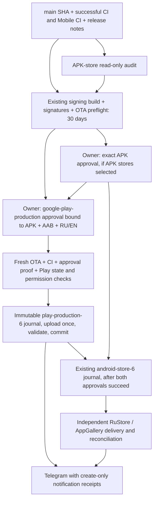

# Android 1.1.0 (6): production delivery

M7.RELEASE.2 extends `Store delivery`; it does not run a release as part of PR CI.
Only an owner-started workflow on `main` can publish. Development tests use HTTP
fakes and never upload APK/AAB files to any store.

## Delivery architecture



`play_target=closed` is the default. The old `google-play` environment, `PLAY_TRACK`
(`alpha`), closed-test refusal of public tracks, release status/review settings,
iOS/TestFlight path and delivery records remain in place. `include_play` keeps its
old meaning for APK-store runs. `play_target=production` selects Android and always
builds both signed files; it never reads closed-test credentials or `PLAY_TRACK`.

The build still uses the existing app signing key for the universal APK and upload
key for the AAB. Both existing validators, production OTA byte checks and catalog
preflight must pass. Notes are read from the **selected source SHA**, not the newer
workflow checkout. Missing, invalid UTF-8/BOM/control characters, blank or oversized
notes stop the gate before store access. Only Android **1.1.0 (6)** is accepted by
the production path; changing the release requires a separate reviewed change.

Approval displays the SHA-256 of the production manifest in the job name. That
manifest includes source/tooling SHA, APK SHA-256, AAB SHA-256, both texts and the
release check. It is recomputed from the downloaded bytes and compared with the
build output after approval. Review `android-verify-reports` / `android-release`
and their manifest/checksums before approving. APK-store approval retains its
existing exact-APK manifest digest and immutable approval artifact.

The production job checks the environment's owner reviewer, no-admin-bypass and
main-only branch policy, plus the owner's actual approval in the current run's
GitHub review history. A declined/missing approval cannot reach a store upload.
For a combined run, APK journal initialization additionally requires successful
`play-production`; rejecting that approval therefore prevents APK-store writes too.

After approval, the job repeats exact-source CI checks and the signed OTA catalog
preflight (at least 30 days). Before upload it lists bundles, APKs and **all** tracks,
including custom/form-factor tracks. Consumed/higher codes and foreign production
drafts, paused or staged rollouts fail closed. Wrong wire types, unknown states or
incomplete responses fail closed. Completed older releases can be superseded by
the requested full production release; testing tracks are not updated.

A no-op `tracks.update` of the existing production configuration and
`edits.validate` probe production write access in an **uncommitted** edit before
any bundle upload. Verify deletes that edit. Delivery uses `completed`, validates
again, and commits with `changesNotSentForReview=false`. There is no automatic
fallback to `draft`, review bypass, another service account or another versionCode.
An API refusal stops the path. Console prerequisites (production access, app content,
country availability, initial app setup) must already be satisfied.

Google API mutations have create-only intent/receipt assets in draft GitHub release
`play-production-6`, separate from APK journals. A committed release counts as this
delivery only if the journal, bundle digest, unique release name and both notes
match. A lost commit response can be reconciled by re-running the failed job with
the original artifacts; no second upload occurs. An uncertain upload/failed commit
that cannot be proven remains `UNKNOWN` and requires inspection, never a blind retry.
New bytes/source/tooling cannot adopt the existing journal.

`SUBMITTED` means the production edit was committed, **not** that Google has made
it publicly available. Review and managed publishing remain under Google's control.
Play has no review-completion polling here. Telegram reports this distinction and
uses the same create-only intent/receipt mechanism to avoid duplicate sends.

## GitHub configuration

Created on 2026-11-15: environment `google-play-production`, ID `27362343932`.
Read-back confirmed the following protections:

| Setting | Required value |
|---|---|
| Required reviewer | User `AlexeyKravtsov95` only |
| Deployment branch policy | Custom branch policy: `main` only; no tags |
| Administrator bypass | Disabled (`can_admins_bypass=false`) |
| Prevent self review | `false` (owner starts and explicitly approves the run) |
| Wait timer | 0; reviewer approval is still mandatory |

The owner must supply these **new environment-scoped values**:

| Kind | Name | Value / permission |
|---|---|---|
| Secret | `PLAY_PRODUCTION_SERVICE_ACCOUNT_JSON` | Google service-account JSON key for this application with production release permission; never a repository-level or test-key fallback |
| Variable | `PLAY_PRODUCTION_SERVICE_ACCOUNT_EMAIL` | Exact `client_email` of that approved production principal |

Enable Google Play Android Developer API for its project and grant application
access in Play Console, including **Release to production, exclude devices, and
use Play app signing** (`CAN_MANAGE_PUBLIC_APKS`) and the read access needed for
bundles/APKs/tracks. Google Cloud IAM roles alone do not grant Play Console access.
Testing-only permission is insufficient. The production probe and subsequent API
responses are authoritative; account selection alone is not proof of permission.
Neither secret nor email was copied from `google-play`, and neither was populated
with a guessed value during development.

No new RuStore, Huawei, signing, OTA or Telegram credentials/variables are required.
Keep all existing environment-scoped values described in
[`ci-delivery.md`](../ci-delivery.md) and [`android-public-stores.md`](../android-public-stores.md).
`android-public-release` must retain its owner-only reviewer and main-only policy.
`android-stores`, `android-signing` and `notifications` retain their main restrictions.
The production job uses `contents: write` for immutable journal assets and
`actions: read` for CI/review history. The production Telegram job uses existing
`notifications` secrets and `contents: write` only. No credentials enter PR jobs.

## Owner: verify, then deliver

After reviewing/merging the PR yourself, choose a full SHA on `main` whose **CI and
Mobile CI** have both completed successfully. Use the same SHA for verification
and delivery. Configure the new production environment values first.

The existing `android-store-reconcile.yml` workflow was found **disabled** in GitHub.
A read-only `inspect_only=true` dispatch on 2026-11-15 was refused with HTTP 422;
no inspection or publication job started. It was not enabled during development.
After merging this PR yourself, enable that workflow before delivery:

```bash
gh workflow enable android-store-reconcile.yml
```

The updated workflow passes `--version-code 6` for every mutating reconciliation,
including manual requests. Thus enabling the scheduler after this PR is merged
cannot load or modify `android-store-5`. An explicit historical ID remains available
only for read-only `inspect_only=true`. The CLI's unscoped legacy behavior is retained
for compatibility; the workflow always supplies the scope. Do not enable the old
unscoped workflow definition before this PR is merged.

Run this **yourself** for all three stores (publication commands were not executed during development):

```bash
gh workflow run store-delivery.yml --ref main \
  -f revision=<FULL_MAIN_SHA> -f platforms=android -f play_target=production \
  -f apk_stores=both -f include_play=false -f mode=verify
```

Verify builds/signs/checks both files, audits APK-store codes, validates both texts,
checks production access in an uncommitted Play edit, and uploads no files to a
store. Production verify transfers signed bytes between jobs as an Actions artifact;
legacy closed verify still retains only reports/checksums. Owner approval is also
required for the protected production verify job to access production credentials.

Resolve any pending previous release first **in its own owner-controlled process**.
Do not rerun version 5 delivery or delete/overwrite its journal to unblock version 6.
The new code-6 audit refuses foreign drafts/reviews in the selected APK stores.

Once verification is accepted, start:

```bash
gh workflow run store-delivery.yml --ref main \
  -f revision=<SAME_FULL_MAIN_SHA> -f platforms=android -f play_target=production \
  -f apk_stores=both -f include_play=false -f mode=deliver
```

Review the build evidence, then explicitly approve `android-public-release` and
`google-play-production`. They are separate protections. Verify and deliver build
separately, so approve the **deliver run's** manifest/bytes, not a previous run's hash.
For Play-only use `apk_stores=none`. For APK stores without Play retain the old
`play_target=closed`, `include_play=false` selection. Closed-test invocations need
no production credentials and continue to use `alpha`.

After any uncertain store write, use **Re-run failed jobs of the same run**, retaining
the original signed artifact and approval identity. Do not rebuild a different AAB
or delete intent assets. Reconciliation refuses any consumed code it cannot prove.
Play errors may leave only a private edit (deleted when possible) and a durable
intent; inspect Console and the journal before taking further action. No code bump,
foreign release modification or journal-reset escape hatch is included.

RuStore and AppGallery continue through the existing scheduled reconciliation and
independent per-store results, with Telegram transitions. One store's API failure
never turns another store's pending/review status into a successful publication.
A failed Play gate blocks the initial APK-store delivery of a combined run.

## Notes and API limitations (official references checked 2026-11-15)

Only these committed release files supply version 6:
`notes-ru.txt` and `notes-en.txt` in this directory. `android-store-notes.txt` remains
for historical compatibility and is never read for Android 1.1.0.

| Store | API / payload | Limit and behavior |
|---|---|---|
| Google Play | `edits.tracks.update`, `releaseNotes=[{language,text}]` for `ru-RU`, `en-US` | 500 Unicode characters per language; same texts in closed and production paths |
| RuStore | Draft creation, `whatsNew` | 5000 characters; current Russian text, approved in manifest |
| AppGallery | `PUT publish/v2/app-language-info?appId=…&releaseType=1`, `{lang,newFeatures}` separately per locale | Conservative 500-character limit from English v2 docs; no listing name/description changes |

Google references: [tracks resource](https://developers.google.com/android-publisher/api-ref/rest/v3/edits.tracks),
[release note length](https://support.google.com/googleplay/android-developer/answer/9859348?hl=en),
[production permission](https://developers.google.com/android-publisher/api-ref/rest/v3/grants).
RuStore reference: [draft creation and whatsNew](https://www.rustore.ru/help/en/work-with-rustore-api/api-upload-publication-app/create-draft-version).
Huawei reference: [localized newFeatures update](https://developer.huawei.com/consumer/en/doc/AppGallery-connect-References/agcapi-language-info-update-0000001158245057/).

AppGallery **supports the required release-note fields**. The automated update runs
only after the attached APK matches the approved hash/size/code and is ready to
submit; the candidate is checked before each language write and again before
submission. RU/EN must already be enabled in the listing. The API requires `appName`
when adding a new language, so this pipeline does not create languages or invent
listing text. Metadata rejection prevents automatic submission. Each language has
its own durable intent/receipt; an uncertain response stays `UNKNOWN`, preventing
submission and repeated metadata writes.

The API updates the current candidate and supplies no conditional revision token
for these writes. Do not edit the Console candidate concurrently. A missing locale,
account/region restriction or uncertain metadata response needs a **manual owner
inspection**: verify the exact candidate package ID/hash/code, compare both texts
with this run's approved manifest, and complete language setup or notes in Console
if required. Submission then remains an explicit owner action unless the original
journal can prove both API receipts. No automated bypass or mutation of historical
records is provided. This is a recovery limitation, not a claim that Huawei lacks
release-note support.

## Historical android-store-5 audit

Read-only GitHub inspection on 2026-11-15 found draft release ID `433118574`, target
`9e9d9e188c5a0a10c2e573640b0e0d171f9eebf5`, manifest digest
`47a982f71fb8aee29cdcf4bb2d34fca9542e34f92dceaf922631ba9716b593b9`.
Its last recorded states (2026-11-04) are RuStore `SUBMITTED` with raw `DRAFT`
(version ID `2064929703`), and AppGallery `CONFLICT` because the candidate does not
match the approved package. This is journal evidence, not a fresh live store probe.
The attempt to refresh this evidence through `inspect_only=true` was refused by
GitHub because the workflow is disabled (HTTP 422). No store job started, so a fresh
live store state remains unverified. No historical asset/state was edited and no
store credential or version-5 upload was used. Version 6 uses `android-store-6` and `play-production-6`; legacy v1
manifests parse unchanged and never receive the new localized metadata writes.

## Validation

Local validation on 2026-11-15: delivery tests **262 passed**; Ruff lint/format passed;
mypy passed for 125 source files; dataset sync passed for 50 files of 5 builds;
actionlint passed with the existing custom `xcode-27` runner label allowed.
`./gradlew :shared:jvmTest :composeApp:desktopTest :composeApp:assembleDebug --console=plain`
passed in 7m 8s: 383 shared JVM tests and 948 desktop tests (64 skipped), no failures.
See the PR for full pytest and GitHub CI results. Mobile CI's PR paths now include
the delivery workflow/scripts and release-note files, so changes exercise the
existing artifact validators and temporary-key signing self-tests. Store/API behavior
is tested using offline transports, including approval refusal, all-track code
conflicts, wrong wire types, notes validation, insufficient production permission,
lost/failed commits, independent store errors and legacy reconciliation.
No actual delivery, store upload, OTA catalog/signing-key change or merge is part
of this milestone's implementation verification.
